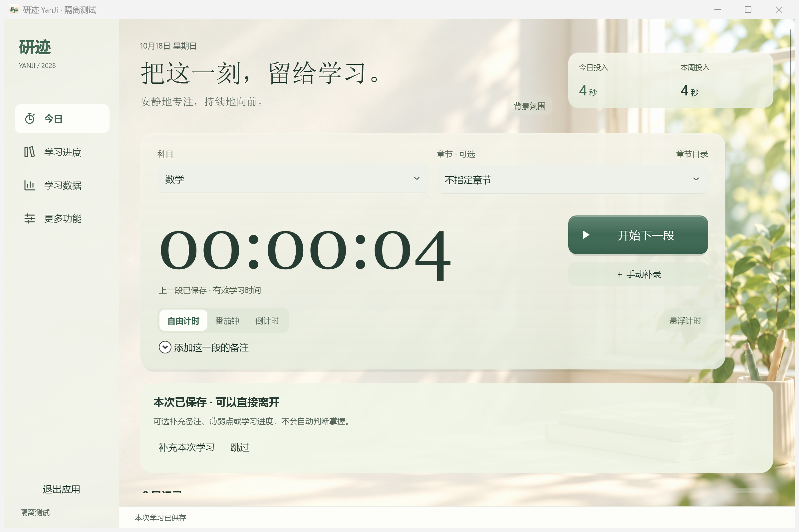
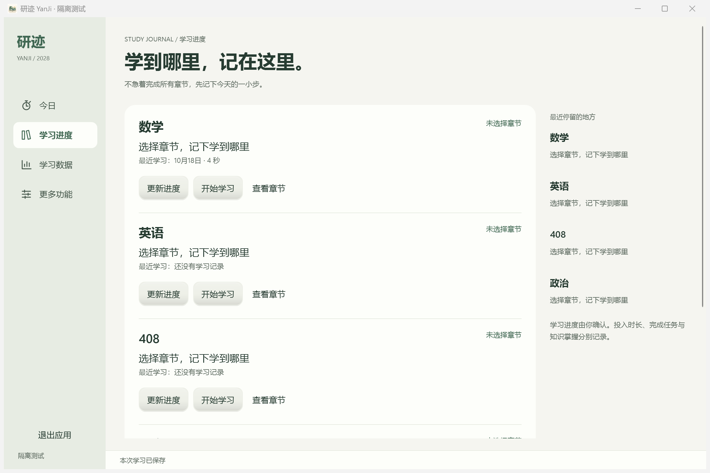
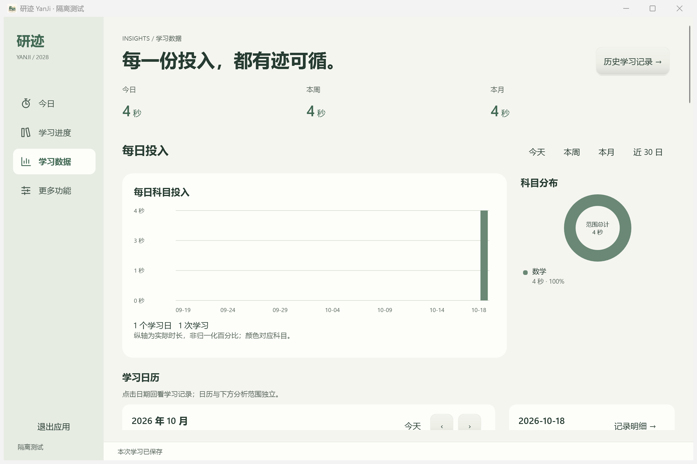
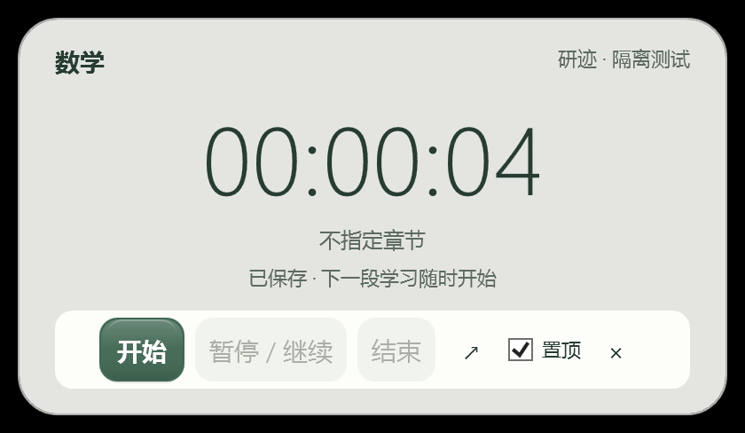

# 研迹 / YanJi

**把每天的专注、章节进度和学习回顾，安静地记在一起。**

研迹是一款面向考研学生的本地 Windows 学习管理软件。选择科目，开始学习，记下学到哪里；日常记录尽量在 1～3 分钟内完成。无需账号、服务器或云同步，不强制连续打卡。

**当前版本：YanJi V0.4.0 Beta。** Beta 仍有实机兼容性限制，不代表 Stable。项目地址为 [Chemic666/yanji](https://github.com/Chemic666/yanji)；当前材料和程序尚在本地审核，**尚未上传源码或发行附件，暂无公开可下载版本**。

## 三个日常页面

- **今日**：自由计时、番茄钟、倒计时、暂停、结束保存与手动补录。只选科目也能开始，章节、任务和备注均可选；支持半透明迷你计时器。
- **学习进度**：记录数学、英语、408 学到哪里、最近学习内容和下一步计划。不计时也能保存进度，完整知识树按需展开。
- **学习数据**：直接查看今日、本周、本月时长、学习日历、趋势、科目分布、章节投入、热力和复盘，并下钻到原始记录。

学习任务、薄弱点、知识包、历史修订及备份恢复保留在相关入口。学习时长、章节进度、任务完成与知识掌握分别记录，不用投入时长自动推断学习成果。

## 真实界面

以下为**真实 WPF 窗口与隔离演示数据**，保留“隔离测试”标识；不是设计稿，也不是正式用户环境截图。取自最新 UI-Copy 验收基线，本轮 Beta 只调整版本元数据和发行材料，未改变冻结的「澄境」界面。精确版本和哈希见[截图来源](docs/screenshots/README.md)。



<details><summary>学习进度、学习数据与迷你计时器</summary>







</details>

## 数学、英语和 408 参考目录

- 数学一/数学二区分适用范围，切换展示不删除历史进度。
- 英语一/英语二按词汇、语法、长难句、阅读、翻译和写作等复习模块组织。
- 408 包含数据结构、计算机组成原理、操作系统和计算机网络，共 177 个参考节点，保留旧 145 个节点的外部 ID。

新档案可按需应用参考目录；已有目录不静默覆盖，更新预览差异并保护本地修改。这些是自编参考目录，**不是官方 2028 年完整考纲**，不附商业教材、题库或讲义正文。[范围与来源](docs/V04-SIMPLE-REFERENCES.md)

## 系统要求与安装

支持 **Windows 11 x64**。Windows ZIP 包含 .NET 运行时，使用时无需安装 SDK、创建账号或联网。

公开发行获准并上传后，请仅从[项目 Releases](https://github.com/Chemic666/yanji/releases)下载 `YanJi-v0.4.0-beta.1-windows-x64.zip` 和 `SHA256SUMS.txt`。当前该附件尚未公开上传。

1. 核对 SHA-256，完整解压到新的可写目录；不要覆盖旧安装，也不要在压缩包内直接运行。
2. 双击 `YanJi.exe`，创建档案，选择方向或暂未确定，按需应用参考目录。
3. 选择科目即可开始学习。[基础使用说明](docs/USER-GUIDE.md)

```cmd
certutil -hashfile YanJi-v0.4.0-beta.1-windows-x64.zip SHA256
```

程序**尚未代码签名**，SmartScreen 表现未验证。哈希用于核对内容，不等于签名或安全认证；出现警告先核对来源，不要关闭系统安全功能。

## 本地数据、隐私与备份

普通启动默认使用 **`%LOCALAPPDATA%\YanJi`**，不随程序位置改变。隔离试用必须显式使用 `YanJi.exe --test-mode --data-dir "D:\YanJi-Isolated-Trial"`；仅解压到另一位置不代表数据隔离。参数无效时不回退正式目录。

软件没有应用自建遥测上传、在线账号、云同步或 AI 分析。操作系统、开发工具和用户自行同步目录的行为不在此范围。用户的学习记录、个人资料与备份不会因为软件开源而公开或变更许可。

设置与数据中可进行完整备份、校验、恢复和 CSV 导出。**恢复是完整替换，不合并**，请保留恢复前备份；CSV 不能代替完整备份，也不要只复制正在使用的 SQLite 主文件而遗漏 WAL/SHM。备份未加密，请自行保管。

**旧版本数据库不会自动迁移，也不会自动导入旧候选 data 目录。** Beta 建议从新档案试用。不要把旧库直接复制进新版；回退应使用对应旧程序和升级前备份，详见[升级与回退](docs/UPGRADE-ROLLBACK.md)。

## Beta 已知限制

- 未代码签名，SmartScreen 和干净 Windows 离线环境尚未完整实测。
- 物理微软拼音候选及 Enter / Ctrl+Enter 尚未完整实测；自动输入检查不能替代。
- 真实睡眠、休眠恢复未完整实测，不确定时间不能自动当作有效学习。
- 本机 200% DPI 有既有证据，100% / 125% / 150% 和其他设备仍有缺口。
- 曾观察到偶发约一秒的未归因停顿；没有每 15 秒整页重建复发证据，不能保证完全无卡顿。
- 先前约 77 分钟运行观察按要求缩短，不能写成数小时耐久通过。
- 知识目录不保证覆盖所有考试内容；学习投入不等于掌握或验收通过。

维护者已接受将以上验证缺口作为 Beta 限制披露；它们仍是 **NOT TESTED**，不是已经通过。[Beta 发行说明](docs/RELEASE-V040.md)

## 反馈与参与

普通问题可在[项目 Issues](https://github.com/Chemic666/yanji/issues)提供版本、复现步骤和脱敏截图；本轮未创建任何 Issue。**不要上传学习数据库、完整备份、私人路径或凭据。** 安全问题先阅读 [SECURITY.md](SECURITY.md)，私密渠道未确认前不要公开攻击细节。

开发使用 C#、WPF、.NET 10、SQLite 与 MVVM，见 [CONTRIBUTING.md](CONTRIBUTING.md)。欢迎小范围、可复现、附必要验证的改进；日常使用不需要理解这些技术。

## 许可证与素材

原创软件代码采用 [Apache-2.0](LICENSE)，范围见 [COPYRIGHT.md](COPYRIGHT.md)。第三方组件与开发 Skill 保留各自许可和声明，详见 [THIRD-PARTY-NOTICES.md](THIRD-PARTY-NOTICES.md)。自编参考目录元数据按包内 CC0-1.0 声明，不授权外部教材正文。

应用图标、原始 A「澄境」概念图和窗景背景由维护者确认来自 AI 工具，未使用第三方网站图片；截图来自真实程序。**图片不因代码许可证自动获得相同许可**，精确文件、生成记录和仍待决定的再分发范围见[素材来源说明](docs/ASSET-RIGHTS.md)。当前历史隐私和素材许可审核未完成，尚未执行公开发行。
